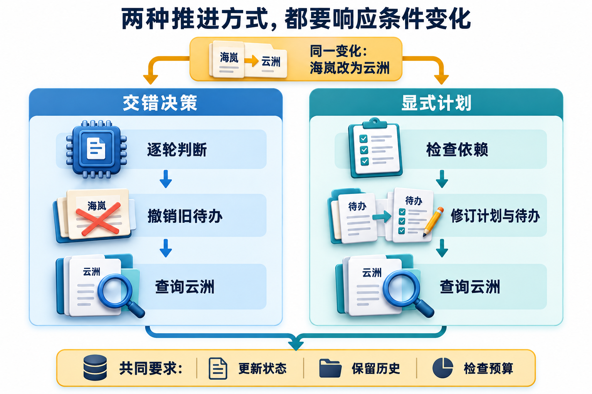

# 08 · 规划与多 Agent

**规划把任务拆成可以执行和验收的步骤。** 每一步都要写清楚依赖哪些信息、完成后交付什么。执行途中出现新证据时，再判断哪些步骤受影响，哪些结果还能用。

步骤多的任务，一个 Agent 也能完成。需要分别管理上下文、工具权限或独立判断时，才值得把部分工作交给多个 Agent。

## 工作流与动态规划

| 组织方式 | 执行特点 |
| --- | --- |
| **固定流程和路由** | 步骤和分支预先定义。先判断走哪条路径，再执行相应流程。 |
| **交错推理与行动（ReAct）** | 根据已有观察判断下一步。执行动作后，把新观察用于后续判断。 |
| **先规划再执行** | 先列出步骤和依赖。执行中检查前提，必要时更新待办。 |

已知步骤可以写成流程，只在需要判断的环节留出选择。目标清楚、取得结果的路径不确定时，观察驱动的循环能逐步补充信息。依赖较多时，显式计划便于检查漏项和找出可并行的步骤。

### 计划与执行反馈

**反思**是根据反馈检查并修正下一次尝试。可以保留明确的失败原因、证据缺口和改法。下一轮使用这些记录时，条件变化要重新判断。修订结果仍按原任务标准验收。

## 依赖、并发与重规划

先明确各步骤必需的输入。依赖尚未满足的节点继续等待。可以同时开始的步骤，共用已确认条件和一致的证据口径。汇总要等必要分支完成，再核对每份结果的版本和范围。

用户更正条件后，把依赖旧值的证据、结论和未派发动作标为失效。已发出的操作按实际状态处理。更新待办时同步更新任务版本。派发前检查步骤使用的版本，避免旧队列继续执行。

并行分支共享总期限、调用配额和费用预算。一个分支遇到临时故障，按规则只重试受影响的部分。截止后保留已核实的结果，明确哪部分缺失。整体能否交付，取决于原先定义的完成条件。

## 多 Agent 的交接与汇总

每次交接都应带上子任务目标、可用输入、权限范围和完成标准。返回结果要区分已完成、缺少资料、失败和取消。需要采纳的主张，应带上证据和来源版本。

多个分支共享状态时，先规定谁能写哪些字段。同一份证据按稳定编号去重。结论冲突时，核对各自的来源和适用条件。两路读到同一份材料，只能算同一个证据来源。

负责汇总的一方核对必需分支是否完成，并对最终交付负责。子任务只能使用分配给它的能力。涉及外部写入时，仍按同一套权限、审批和结果校验执行。

## 评估协作成本

用同一批任务对照单 Agent 和多 Agent。固定权限、模型和验收标准。分别看任务完成率、证据缺失率、总成本和端到端延迟。

并行读取能节省多少等待，取决于这些步骤是不是彼此独立。拆开之后，还要付出传递信息、等待汇总和处理冲突的成本。只有看到了稳定收益，才值得保留这层分工。

<!-- question-links:start -->
## 配套面试练习

先合上正文讲一分钟，再用追问和案例检查理解。每题都可以跳回对应学习内容。

展开本章相关面试题

- [Q010 ReAct 与先规划后执行有何不同？](../questions/Q010.md#q010-react-与先规划后执行有何不同)
- [Q013 多个分支何时可以并发？](../questions/Q013.md#q013-多个分支何时可以并发)
- [Q015 什么时候值得使用多个 Agent？](../questions/Q015.md#q015-什么时候值得使用多个-agent)
- [Q016 多 Agent 如何交接，冲突如何处理？](../questions/Q016.md#q016-多-agent-如何交接冲突如何处理)

<!-- question-links:end -->

[上一章：07 · 记忆与状态](07-memory-and-state.md) · [基础原理目录](README.md) · [下一章：09 · 评测](09-evaluation.md)
