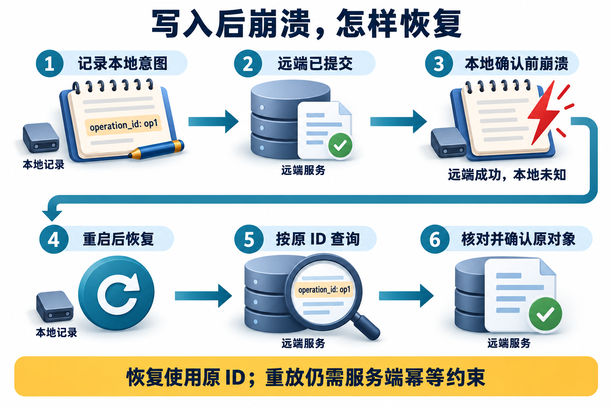

# 10 · 可靠性与安全

**可靠性要处理执行中断和结果未知。安全要把可执行的动作限制在授权范围内。** 两者都要由运行时和服务端落实。模型可以提出请求，执行前还需要独立校验。

只读动作也会涉及敏感信息。创建、修改或发送还会改变外部状态。系统要知道当前允许做什么、操作实际做到哪一步，以及中断后如何继续。

## 动作校验与审批

执行前检查工具是否允许、参数是否有效、当前身份是否有对象权限。身份和租户来自可信会话。权限随对象和动作变化，每次执行都要按实际目标核对。

对需要审批的动作，展示目标、完整的关键参数和影响。批准绑定到明确的动作版本。对象或参数变化后，要重新核对批准是否有效。真正执行时，再检查当前权限和业务状态。

## 超时与结果未知

**超时只能说明调用方没有按时拿到结果。** 服务端可能还没收到请求，也可能已经提交，只是回执丢失。运行时应该记录结果未知，保留用于回查的操作编号。

读操作按服务合同判断是否允许重试。写入结果未知时，优先用原编号查询或对账。确认已完成后补记本地结果。查询暂未找到记录时，先确认服务如何表示正在处理或尚未同步。按原编号重放前，要核对服务的幂等范围和有效期。其余情况保留未知状态，暂停派发。

## 幂等与稳定的操作编号

**幂等是同一个操作被重复处理时，约定的业务效果与执行一次相同。** 日志里的请求编号可以随每次尝试变化。用来识别业务意图的操作编号，在重试或恢复时要保持稳定。

服务端校验调用者、作用范围、操作编号和实际参数。同一个编号对应的内容发生变化时，应明确返回冲突。用户确实发起另一笔业务操作时，则分配新的编号。只按参数内容去重，会把参数相同的两笔独立操作误当成一笔。

去重记录与实际写入要有一致的提交约定。两者分开保存，故障时可能只成功一边。还要考虑并发请求、重启和去重记录过期。仅凭调用方加了一个编号，无法判断服务端是否能安全处理重放。

## 本地进度与外部结果

派发写入前，持久保存待执行意图和操作编号。收到确认后，再保存外部对象和处理结果。恢复时读取这份意图，用原编号查服务状态。队列里的待办可能已经做完，只是本地还没确认。

判断恢复成功，要查外部对象数量和关键字段。随后验证本地状态能否与服务端对上。仅用本地完成标志无法验证外部副作用。

## 重试、期限与取消

| 观察 | 处理 |
| --- | --- |
| **参数错误或缺少条件** | 修正或补充请求，必要时结束。 |
| **权限不足** | 拒绝动作，按授权流程处理。 |
| **临时失败且允许重试** | 在剩余预算内重试。用退避和随机等待分散请求。 |
| **写入结果未知** | 按原操作编号对账，再根据服务约定决定下一步。 |
| **任务取消或超时** | 停止新的动作，确认已派发动作的真实状态。 |

多个调用层各自重试，会把尝试次数相乘。明确由哪一层负责，并让它使用任务剩余的时间和次数。计算本机已经经过的时间用单调时钟。日志里的日期时间另行记录。

取消本地等待后，远端动作可能仍在执行。界面和状态记录应区分已停止派发、远端已取消和外部结果仍待确认。

## 外部文本与执行隔离

网页、文档和工具回包都可能夹带要求模型采取行动的文字。这些文字属于外部数据。它们试图改变模型遵循的指令或触发额外动作时，属于**间接提示注入**。执行层按可信指令和当前授权决定能做什么。

权限在读取受限内容前生效。对工具可读的资源、可写的目标和允许的数据出口分别限制。需要隔离的工具放在权限受限的环境中运行。日志也按敏感程度控制访问和保留期限。

## 故障与安全验收

测试时分别覆盖权限拒绝、审批后参数变化、提交后回执丢失，以及恢复时重复派发。核对拒绝是否发生在执行前。对结果未知的动作，验证系统能否用原编号找到真实状态。

线上复盘沿任务编号、操作编号和执行尝试查记录。重点看系统用了哪些权限、窗口内是否有外部写入，以及它什么时候确认成功。终态要由可核实的结果支撑。

<!-- question-links:start -->
## 配套面试练习

先合上正文讲一分钟，再用追问和案例检查理解。每题都可以跳回对应学习内容。

展开本章相关面试题

- [Q014 Checkpoint 能保证恢复后不重复扣款吗？](../questions/Q014.md#q014-checkpoint-能保证恢复后不重复扣款吗)
- [Q041 工具失败后应该怎样重试？](../questions/Q041.md#q041-工具失败后应该怎样重试)
- [Q042 什么是幂等，为什么“工具超时”不等于“工具没执行”？](../questions/Q042.md#q042-什么是幂等为什么工具超时不等于工具没执行)
- [Q043 人工审批应该放在哪里，审批后还能改参数吗？](../questions/Q043.md#q043-人工审批应该放在哪里审批后还能改参数吗)
- [Q044 怎么应对网页或文档中的 Prompt Injection？](../questions/Q044.md#q044-怎么应对网页或文档中的-prompt-injection)
- [Q045 工具沙箱、参数校验和 ACL 分别解决什么？](../questions/Q045.md#q045-工具沙箱参数校验和-acl-分别解决什么)
- [Q046 Checkpoint 能保证崩溃恢复后不重复执行工具吗？](../questions/Q046.md#q046-checkpoint-能保证崩溃恢复后不重复执行工具吗)
- [Q047 用户点了停止，怎样取消流式 Agent？](../questions/Q047.md#q047-用户点了停止怎样取消流式-agent)
- [Q048 如何防止 Agent 死循环与故障扩散？](../questions/Q048.md#q048-如何防止-agent-死循环与故障扩散)
- [Q049 设计一个企业知识库客服 Agent，你会怎样开始？](../questions/Q049.md#q049-设计一个企业知识库客服-agent你会怎样开始)
- [Q051 设计一个能创建、分派工单的 Agent，状态如何流转？](../questions/Q051.md#q051-设计一个能创建分派工单的-agent状态如何流转)
- [Q055 Agent 项目怎样做测试，哪些该 mock？](../questions/Q055.md#q055-agent-项目怎样做测试哪些该-mock)
- [Q056 线上突然回答变差，你会如何排查？](../questions/Q056.md#q056-线上突然回答变差你会如何排查)

<!-- question-links:end -->

[上一章：09 · 评测](09-evaluation.md) · [基础原理目录](README.md)
