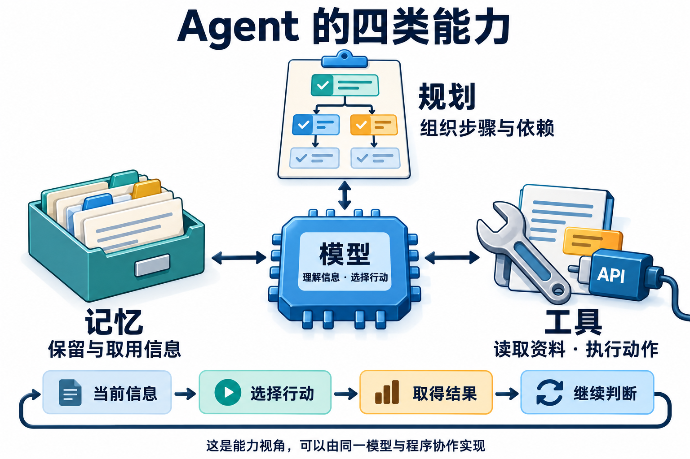
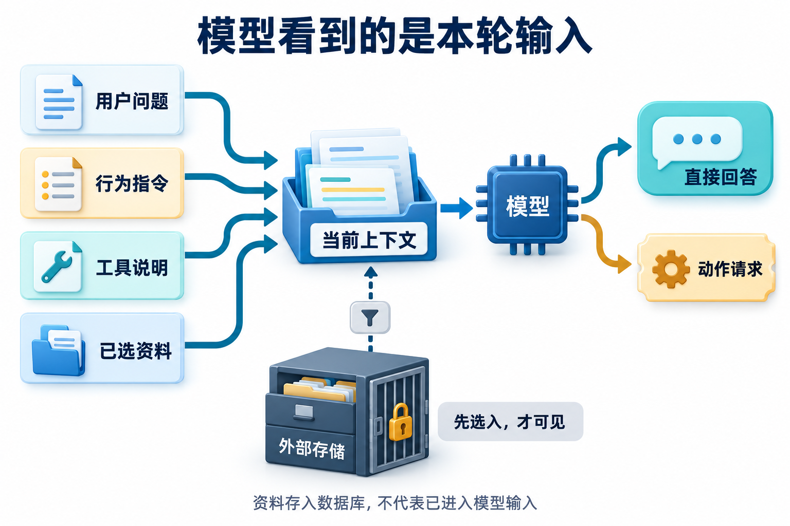
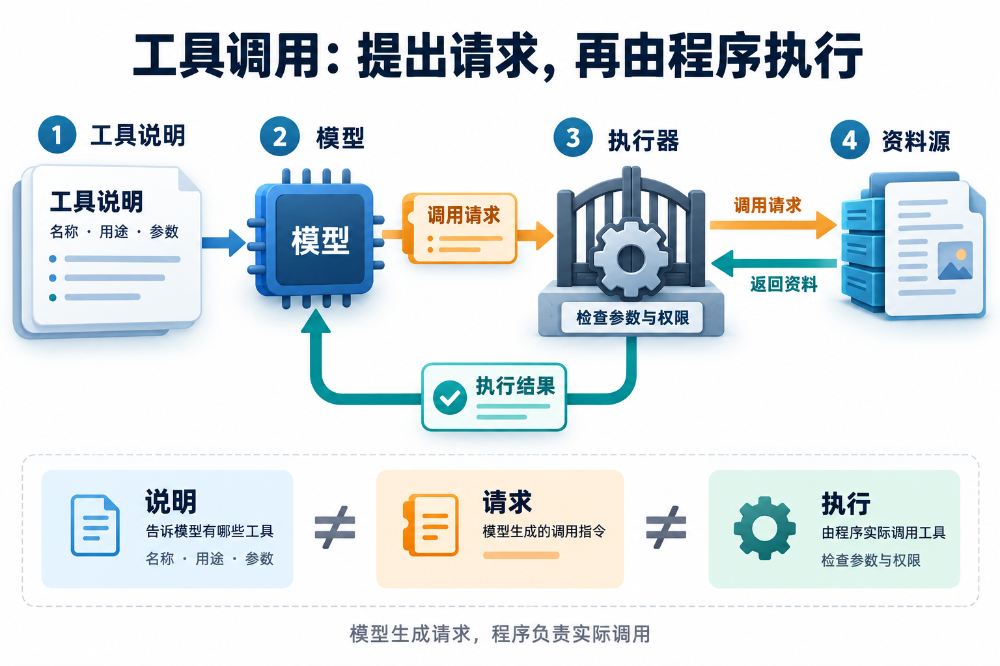
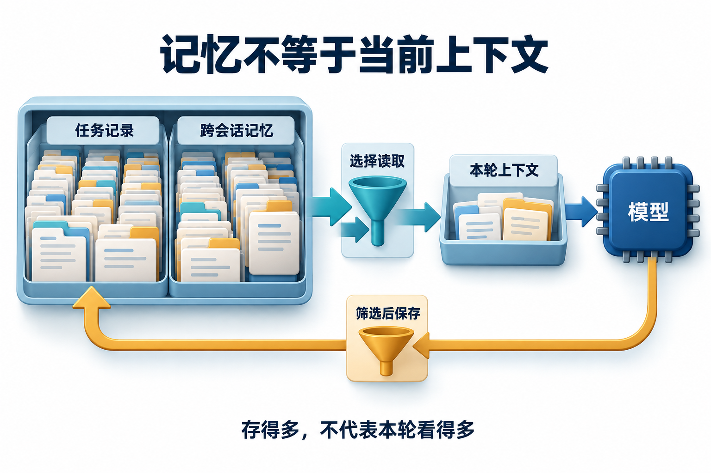
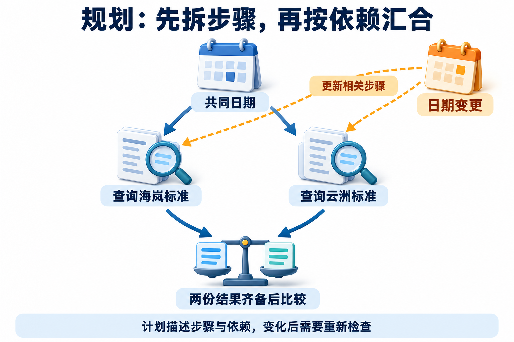
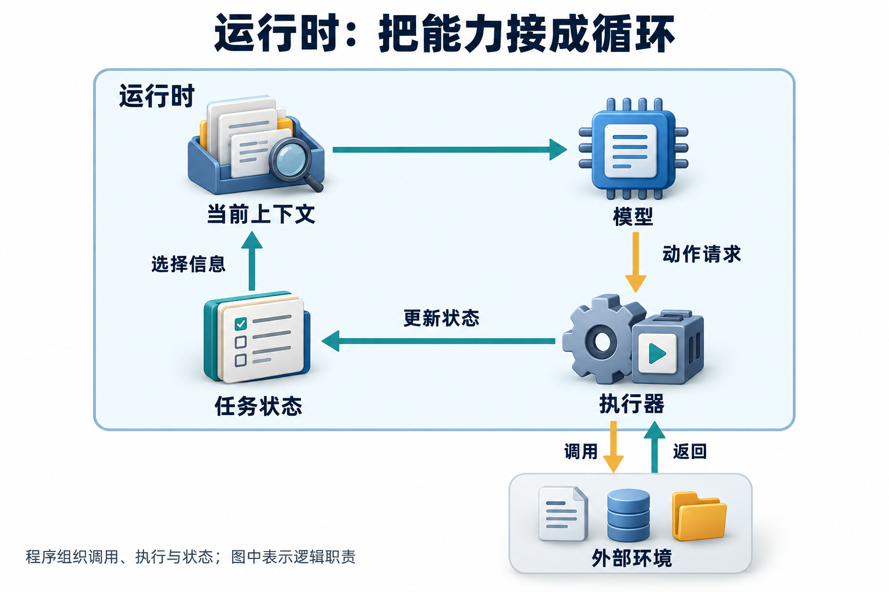

<!-- Generated question article; edit the canonical question in docs/foundations/01-agent-and-llm.md, then run python3 scripts/check_repo.py --write-index. -->

# Q001 什么是 Agent，和普通 LLM 调用有何区别？

**优先级：P0**

本题导航：[口述短答](Q001.md#简要回答) · [概念与机制](Q001.md#详细解析) · [三个追问](Q001.md#常见追问) · [完整案例](Q001.md#实战案例) · [动手练习](Q001.md#动手想一想)

## 简要回答

**智能体（Agent）是围绕目标，根据当前信息选择行动，再利用结果继续推进的系统。** 本题讨论以大语言模型（Large Language Model，LLM）为决策核心的 Agent。单次模型调用接收一次输入、产生一次响应；固定工作流主要由程序安排步骤和分支；Agent 则让模型根据中间观察动态决定下一步。它常用模型、工具、记忆和规划来完成工作，运行时负责把决定、实际执行和反馈连接起来。是否需要动态选择，要看任务的信息会怎样逐步出现。

## 详细解析

### 单次模型调用、固定工作流与 Agent 的区别

面试时先说明控制路径：应用发出一次请求就结束，还是程序规定后续步骤，或者模型能根据执行结果继续选择行动。三者可以出现在同一个系统中，不能仅凭“用了工具”或“调用了多次模型”判断架构。[架构区分参考](https://www.anthropic.com/research/building-effective-agents)

假设小明问：“2026年11月12日去海岚，酒店每晚650元，超过住宿上限吗？”员工类别由可信用户档案提供。三种实现都可能给出正确结论，差别在于制度缺失、查询失败或用户改条件时，由谁安排后续工作。

| 实现方式 | 正常路径 | 条件变化时的控制方式 |
| --- | --- | --- |
| 单次模型调用 | 应用把问题和有效条款一起传入，取得一次响应 | 本次响应不能自行执行后续步骤，应用决定是否继续 |
| 固定工作流 | 程序安排条件检查、制度查询、金额比较和回答 | 按预先定义的分支澄清、重查或报错 |
| Agent | 模型结合观察选择澄清、查询、补查或回答 | 在允许范围内调整下一动作，运行时检查并执行 |

固定工作流也能处理复杂条件。只有需要根据逐步出现的信息动态选择路径时，才有理由增加模型决策；动态程度越高，越需要可检查的状态、工具约束和停止条件。若任务只是按固定规则比较650与700，用程序计算就足够，不能把增加模型调用次数本身当作收益。

### 用一张图认识四类能力

模型、工具、记忆和规划描述四类职责，不要求部署四个独立模块。回答组成之后，还应解释职责之间传递什么信息，以及应用如何判断工作已经完成。

| 能力 | 传递的信息 | 面试中需要说明的边界 |
| --- | --- | --- |
| 模型 | 对当前输入作出的回答或动作请求 | 生成一个决定，不等于决定已经执行 |
| 工具 | 查询结果、操作回执或错误 | 返回值要有明确含义，并能关联本次调用 |
| 记忆 | 当前条件、已有证据和必要历史 | 已存储的信息还需选择后才能进入本轮输入 |
| 规划 | 子任务、依赖和完成条件 | 列出步骤之后，仍需根据结果检查和调整 |

同一个模型可以同时决策与规划；程序也可以固定部分依赖。简单任务可能只需本轮状态，并不一定需要跨会话记忆。合理的架构解释应从任务需要出发，再说明实际采用了哪些能力。

### 模型：把当前信息变成下一步选择

模型本次能依据的信息来自实际输入，包括任务说明、城市与日期、可用工具及已取得的条款。缺少公司制度时，模型即使熟悉差旅场景，也不能据此确定这家公司的住宿上限。正确的下一步应是获取依据，或者说明仍缺什么。

排查错误决定时，先看该次调用究竟看到了什么。若应用没有装入已经查到的新版条款，应检查输入组装；若条款和条件都正确，模型仍选用旧日期，才进一步分析理解与选择问题。系统提示词可以要求先核对条件，但应用仍需校验实际动作和结果。

讲项目时可以展示一次调用的输入、输出与随后发生的动作，而不能仅以“模型说它查过了”作为证据。生成机制见[Q002](Q002.md)，输入选择与压缩见[Q031](Q031.md)。

### 工具：把语言请求接到真实能力

以制度查询为例，工具声明说明用途、参数和返回内容；模型提出包含城市、出差日期的请求；运行时验证参数、按可信身份执行查询，再把条款或错误交回决策步骤。生成调用参数，只完成了请求阶段。[工具交互参考](https://modelcontextprotocol.io/specification/2025-11-25/server/tools)

工具应返回足够的判断依据，例如金额、单位、适用人员、生效区间和来源。一个孤立的“700”无法说明是每晚、每次还是每人，也无法证明适用于11月12日。遇到超时，应记录尚未取得结果，不能把模型补出的数字当成工具观察。

查询与创建工单还应区别处理：前者取得信息，后者改变业务对象。动作是否获准、是否执行成功，应由相应校验和后端回执确认。工具执行边界见[Q025](Q025.md)，MCP的连接角色见[Q028](Q028.md)，检索如何提供证据见[Q017](Q017.md)。

### 记忆：让前后步骤接得上

记忆要回答两个问题：哪些信息需要保留，下一步如何读到它们。本题至少需要城市、日期、员工类别、报价及已取得的条款。它们可以保存为任务字段和证据记录，无需把所有历史对话逐字传给模型。

任务状态、当前上下文与跨会话记忆的范围不同。状态可以保存在窗口外以便恢复；上下文是这次调用真正读到的部分；跨会话记录用于后续任务复用偏好或经验。存储中存在一条记录，不代表模型本轮已经使用它；把记录存入数据库也不会修改模型参数。

用户更正城市后，要更新当前条件，并标明旧查询不再支持当前结论。旧结果可以留作历史，但不能因“以前查到过”继续装入新城市答案。解释记忆机制时，应同时说明写入、选取、更正和有效性检查；分类与生命周期见[Q030](Q030.md)。

### 规划：把目标拆成有关系的工作

把目标换成“比较海岚和云洲同一天的住宿标准”，计划就需要表达依赖：先确认共同日期和人员类别，再查询两地制度，最后在同一口径下比较。两次独立查询可以并行，但综合回答必须等两边证据齐全；其中一地缺条款时，只能说明已知部分与缺口。

计划不一定要由独立Planner一次写完。程序可以固定依赖，模型也可以取得一次观察后再选下一步。ReAct组织推理与行动交替推进；先生成显式计划的方式则更容易预先检查覆盖范围，两者可以组合。[ReAct原论文](https://arxiv.org/abs/2210.03629)

新反馈可能使部分计划失效。例如出差日期变化后，两地制度都要重新核对适用期，单纯重写最后一段回答不够。两次查询也不意味着必须建立两个Agent，应先说明并行是否有收益，再决定分工。规划方式的取舍见[Q010](Q010.md)。

### 运行时与环境：让能力真正协作

运行时负责准备输入、调用模型、检查动作请求、执行工具、保存观察，再决定继续还是结束。环境是实际交互的用户、制度库与业务服务。模型可以建议查询，只有运行时真正访问制度库并取得返回值，系统才新增了这份证据。

面试中应能沿记录说明：哪个决定触发了哪次调用、结果属于什么条件、状态如何变化、结束依据是什么。框架可以封装循环，却不能替业务定义完成条件。最小循环与停止条件见[Q009](Q009.md)。

## 实战案例

### 回到小明的650元问题

以下只判断金额条件，不创建申请。可信档案提供普通员工类别，用户给出海岚、2026年11月12日和650元/晚；查询得到当日适用上限700元/晚。

| 可观察事件 | 系统应保存或检查的内容 | 验收依据 |
| --- | --- | --- |
| 模型提出制度查询 | 城市、出差日期与调用标识 | 参数对应已确认条件 |
| 工具返回条款 | 700元/晚、适用类别、生效区间与来源 | 返回成功且条款适用 |
| 应用组装下一轮输入 | 当前条件和这份有效证据 | 关键金额与单位未丢失 |
| 生成结论 | 650≤700，仅说明金额未超限 | 结论范围与证据相符 |

若用户接着改为云洲，应用更新城市并重新查询。还没有取得云洲条款时，不应继续使用海岚700元上限；查询失败时，应返回缺口或按预算补查。这样的变化分支，能检验系统是否确实利用观察推进，而不只是重复一条预先写好的成功回答。

### 面试时怎样把架构讲清楚

口述可按“控制方式、职责分工、一次执行、异常分支”展开。先说明模型能选择哪些行动，再用一次真实调用连接输入、请求、执行、观察与结论。最后给出用户改城市或工具失败时的处理，解释完成判断由什么证据支持。四类能力的名称用于组织答案，执行记录用于支撑答案。

## 常见追问

1. **模型已经生成查询参数，为什么还没有取得制度？** 参数是动作请求。运行时还要调用相应函数，取得返回材料；生成请求与实际执行分别发生。
2. **制度存在数据库中，为什么模型这次仍可能没有看到？** 数据要经过读取、选择，进入当前上下文。存储中的全部内容不会自动成为一次调用的输入。
3. **用户把城市改了，计划、状态和工具调用分别会怎样变化？** 状态保存新城市，规划调整受影响的工作，工具查询新城市资料；仍适用的历史信息可以保留。

## 常见误区

只凭工具数量、模型调用次数或提示词长度判断是否为Agent；把四类能力当成必须独立部署的模块；用模型声称“已完成”代替执行与验收证据。

## 动手想一想

用同一住宿问题画出三种控制路径，标明谁安排下一步。再加入“日期未给”“用户改城市”“工具超时”三个条件，逐项说明状态、动作与结束依据。验收时应能区分模型请求、真实执行和已有证据，并指出哪种实现最适合这个任务。

## 学习参考

[完整讲解：Agent组成与协作](../learning/01-system-map.md) · [基础原理](../learning/README.md) · [可选：观察一次完整任务](../learning/00-first-agent.md)

---

[全部题目](README.md) · [下一题：Q002](Q002.md)

[按模块阅读](../docs/foundations/01-agent-and-llm.md#q001-什么是-agent和普通-llm-调用有何区别)
