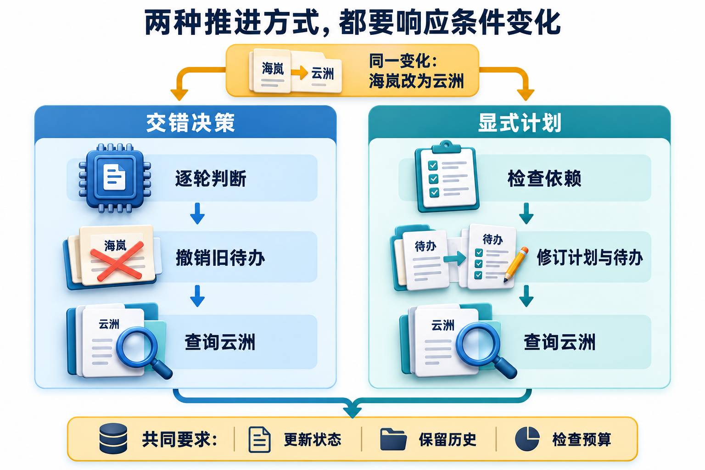

<!-- Generated question article; edit the canonical question in docs/foundations/02-planning-and-orchestration.md, then run python3 scripts/check_repo.py --write-index. -->

# Q010 ReAct 与先规划后执行有何不同？

**优先级：P1**

## 简要回答

ReAct 将推理与环境动作交替组织，根据新观察调整下一步。先规划后执行先列任务分解，再执行和更新计划，适合依赖较清楚的任务。比如比较两地政策，可以先列检索、核对、比较的计划，在每次检索后用局部循环判断证据是否足够。**两种组织方式可以组合**；计划前提失效时要重规划，不能拿旧清单一直往下勾。[ReAct 原论文](https://arxiv.org/abs/2210.03629)

## 详细解析

对照两侧的决定时机，再看更正条件后哪些待办被替换；两种方式都需要利用反馈更新后续工作。

先看工作如何组织。ReAct 把推理与环境动作交错：当前观察支持什么、还缺什么，下一步就针对缺口行动，再根据结果调整。先规划后执行先显式分解目标和依赖，再逐步执行；两者都需要工具观察，区别不在于是否写过一句“先想一想”。一次计划也无法预先知道所有真实返回值。

比较两地政策时，可以先列确认日期、分别检索、核对条件和综合的计划。局部检索又可以采用动态循环：缺例外条款就补查，发现旧版就换有效来源。这个组合把全局依赖和局部探索分开。计划像施工顺序表，能告诉你先铺哪段路，却不能把尚未查到的证据提前填成事实；输入条件改变时，要标记受影响工作并更新计划版本。

取舍看任务是否容易预先分解，以及反馈变化多大。显式计划利于跟踪覆盖与交接，也可能造成机械执行；逐步选择灵活，却容易局部反复探索。两者都需要全局预算、无进展检查和可验收终态。记录决策摘要、计划变更、调用与来源，就能解释为何换路；不需要索取模型隐藏的思维链，也不能把生成的自述当成实际执行记录。评测应比较证据覆盖、无效调用、失效计划继续执行和最终交付。

## 常见追问

1. **面试时需要展示完整思维链吗？** 不需要。提供计划摘要、动作选择依据、实际工具观察与状态变更，便于核对行为；隐藏内部推理不应作为可观测性前提，也不能用自述替代外部结果。
2. **计划发现错误后要全部推倒吗？** 先检查依赖与版本，保留条件仍成立的结果，失效项重新打开。整体重做可能浪费预算，盲目保留又可能传播旧前提，应该用来源与输入关联判断影响范围。
3. **什么时候先规划更有价值？** 目标包含明确子任务和覆盖要求时，计划便于检查遗漏。若信息逐步揭示，可用粗计划约束局部循环；是否值得仍用固定任务比较质量、重做与额外调用。

## 实战案例

任务是查资料后比较两个部署方案。预写计划把某来源标成权威，执行时该来源已失效，初版仍照清单生成结论。改为每次取得材料后检查有效性，失效则更新证据节点与受影响比较项；局部循环寻找允许的替代来源。验收分别记录两种组织方式的轨迹，检查旧来源不进入最终引用、预算内能更新下一步；无法补齐时返回缺口，不能靠多轮改写把未确认说成已确认。

## 常见误区

把工具调用次数多当作推理能力强；把任何“先想一想”的提示都叫 ReAct 实现。计划越长并不天然越完整；没有输入、依赖和验收条件的步骤，很容易只是漂亮清单。

## 动手想一想

为“查资料后比较两个部署方案”分别写两条执行轨迹。验收：加入来源失效后，两种流程都能更新下一步。再修改一个用户条件，标出可以复用与必须重做的步骤，并为两条轨迹设置共同调用上限。

## 学习参考

[规划与多 Agent](../learning/08-planning-and-multi-agent.md)

---

[上一题：Q009](Q009.md) · [全部题目](README.md) · [下一题：Q011](Q011.md)

[按模块阅读](../docs/foundations/02-planning-and-orchestration.md#q010-react-与先规划后执行有何不同)
