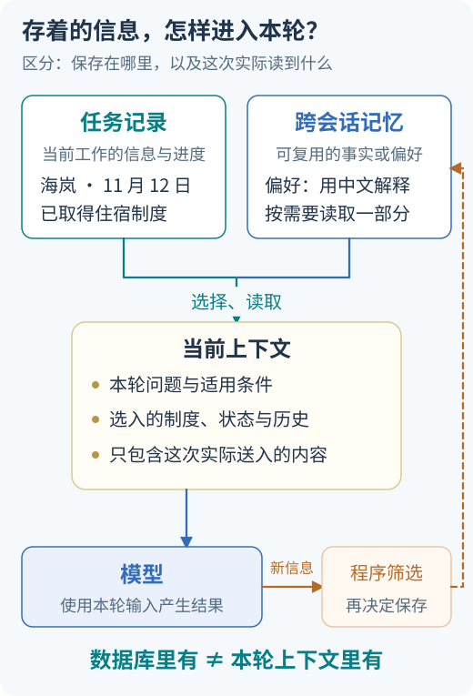

<!-- Generated question article; edit the canonical question in docs/foundations/02-planning-and-orchestration.md, then run python3 scripts/check_repo.py --write-index. -->

# Q011 为什么用状态图组织 Agent？

**优先级：P0**

## 简要回答

状态图把任务信息、执行节点和转移条件显式化。节点读取当前状态并产生更新，边决定下一步；这样能独立检查哪条路径会重试、请求人工输入或终止。图不会自动保证正确，它只是让控制逻辑更可见；业务不变量、状态字段约束和节点测试仍需自己定义。[LangGraph Graph API](https://docs.langchain.com/oss/python/langgraph/graph-api)

## 详细解析

图中的任务记录可以保存工作进度，但只有被选择的部分进入模型输入，工作流状态不等于完整上下文。

状态图让任务数据、执行节点与转移条件显式存在。状态可保存目标、已确认条件、证据指针、错误、待审批动作与预算；节点读取所需字段并产生更新，边依据结果选择下一处。图形本身只展示控制结构，正确性来自字段含义、转移前提与业务不变量，而不是线条看上去很完整。

先为每个节点约定输入、输出和失败。检索节点返回候选与版本，校验节点检查可见性和支持关系，回答节点处理证据充分或需澄清。缺权限和无证据应走不同路径，不能都用一个空列表解释。授权、计费和关键业务更新可以使用确定性代码，只有确实需要判断的部分才调用模型；每个方框都放模型会增加不可控变化。

状态也不是当前上下文的同义词。程序保存的内部审批字段未必全部提供给模型，长期偏好有独立生命周期，大原文可以放外部存储，图内只保留位置、版本和必要摘要。像案卷目录能指到原件，目录本身不能替代原件的访问权限和内容。并发更新还需要字段合并与冲突规则，恢复需要检查点及版本兼容；这些机制各自解决问题，不能因采用了图就省略节点测试、权限重验或外部幂等。

## 常见追问

1. **状态中为什么不直接塞所有文件？** 大文件复制和传递会增加存储、输入和维护成本。保存稳定位置、内容版本、必要摘要与来源，按需取回；读取时仍检查权限，指针失效也要有明确分支。
2. **状态图与记忆有什么关系？** 图状态服务当前任务执行，跨任务记忆有自己的主体、保存与读取规则。二者可能通过存储连接，但状态存在不代表模型本次可见，也不代表写入了模型参数。
3. **框架提供合并规则，冲突就解决了吗？** 合并规则只规定数据更新方式。两份证据金额不同，仍需对齐实体、时间和适用条件；列表追加或最后写入覆盖不能自动决定哪份事实正确。

## 实战案例

教学图从接收进入检索、校验、回答。初版把无权限、旧版与真实空结果都送进“再检索”，导致不断重试。改为让工具返回明确状态，分别转到拒绝、重查版本或缺证据；原文外置，状态保留文档和版本指针。验收对三种输入逐条走图，检查每条分支的终态和字段；大文件不会被无条件重复送入模型，合法引用仍可按权限回查，错误分支不会生成成功文字。

## 常见误区

把所有节点都写成模型调用；支付、鉴权、计费等通常需要确定性代码。图上有一条成功边，不证明它的前置条件已经被检查；状态保存也不能替代真实环境结果。

## 动手想一想

画 `接收→检索→校验→回答`，加入无权限、无证据和来源过期分支。验收：每条分支都有可观察结果。为每个节点列两个字段约束，再模拟原文指针失效，说明应更新哪些状态以及怎样继续或结束。

## 学习参考

[记忆与状态](../learning/07-memory-and-state.md)

---

[上一题：Q010](Q010.md) · [全部题目](README.md) · [下一题：Q012](Q012.md)

[按模块阅读](../docs/foundations/02-planning-and-orchestration.md#q011-为什么用状态图组织-agent)
