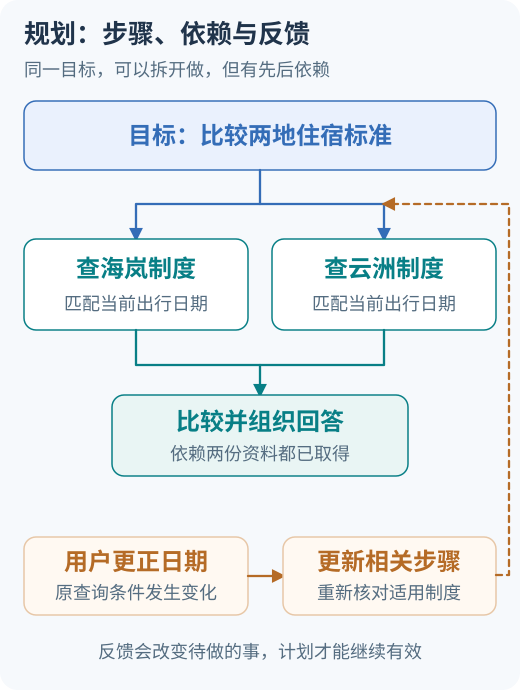

<!-- Generated question article; edit the canonical question in docs/foundations/02-planning-and-orchestration.md, then run python3 scripts/check_repo.py --write-index. -->

# Q013 多个分支何时可以并发？

**优先级：P1**

## 简要回答

没有数据依赖且不会争用同一副作用资源的任务，可以考虑并发，例如分别读取两份公开资料；比较结论则要等所需资料回来。先画“谁等谁”，再决定同时启动哪些分支。还要规定合并、部分失败与超时处理，共享字段需要去重、冲突规则或串行化；调用同时发出去，只完成了调度，最终状态仍需检查。[状态归并参考](https://docs.langchain.com/oss/python/langgraph/graph-api)

## 详细解析

先找两条独立查询，再找汇合点；能否并发由数据依赖决定，比较步骤仍须等待必要结果。

先把任务画成数据依赖。查询两地公开政策，如果日期与人员类别已经明确，两路可以独立读取；比较结论需要两路证据，不能提前把缺失一地当成零或默认规则。若第二个查询要用第一个返回的项目 ID，就存在真实依赖，再快的并发工具也不能补出尚未确定的输入。

接着检查共享资源和副作用。两个读取也可能看到不同版本，需要记录快照、来源时间或明确允许的差异；两个写入若影响同一订单，更要按业务约束协调。退款与发货分别通过检查，不说明组合状态合法。执行前的检查与真正更新之间还可能变化，需要资源侧的事务或条件更新，而不能只靠调度器先问两次“可以吗”。

合并需要字段所有权、稳定结果标识和部分失败策略。分支可返回证据与缺口，协调者按版本去重，再验收最终结论；追加列表只收材料，不替你判断相互矛盾的条款。并发同时占用连接、配额和峰值预算，应有在途上限、统一预留与共同截止时间。理想情况下独立分支缩短关键路径，但排队、限流与重试可能抵消收益。评估应保持任务与质量合同一致，分别看关键路径、资源峰值和失败恢复，不能以启动了多少任务判断优化。

## 常见追问

1. **并发越多，为什么可能反而更慢？** 速率限制、连接与共享服务容量会造成排队和重试。限制在途数量，优先派发必要证据；记录等待和执行时间，再按真实负载选择并发度，不能只看孤立调用耗时。
2. **分支结果都成功，能直接拼起来吗？** 先核对日期、对象、版本和权限口径，再按稳定标识去重。两份成功响应可能内容冲突，最终比较仍要验收；旧计划的迟到结果也不能覆盖新版结论。
3. **一支失败时一定要取消全部吗？** 看任务合同和副作用。如果允许局部报告，可保留成功证据并声明缺口；完整比较是硬要求时就不能交完整成功。已发出的写操作还要确认终态，取消等待不等于撤销。

## 实战案例

两路政策读取分别需 0.8 秒和 1.2 秒，输入已确定，忽略开销时串行为 2 秒，并发读阶段为 1.2 秒。若第二路失败，初版用第一地制度补齐。处理时记录各分支状态与共同预算，只有必要证据齐全才比较；允许部分交付时明确缺哪一地。验收既复算理想等待，也注入重复证据、旧版本与限流，检查去重、版本核对和并发上限，不把下界写成线上 p95。

## 常见误区

对同一订单并行执行“退款”和“发货”；两次独立检查通过也不代表组合动作合法。并发是调度方式，单个执行器也能组织；增加 Agent 数量不能消除数据依赖或业务冲突。

## 动手想一想

两个分支分别返回 `[A,B]` 与 `[B,C]`。验收：写出有稳定顺序的去重结果，并说明一支失败时是否允许回答。给结果标上计划与来源版本，加入一条迟到的旧结果，说明它为何不能覆盖当前比较。

## 学习参考

[依赖与多 Agent 编排](../learning/08-planning-and-multi-agent.md)

---

[上一题：Q012](Q012.md) · [全部题目](README.md) · [下一题：Q014](Q014.md)

[按模块阅读](../docs/foundations/02-planning-and-orchestration.md#q013-多个分支何时可以并发)
