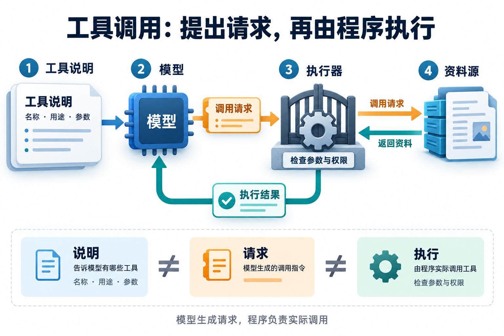

<!-- Generated question article; edit the canonical question in docs/foundations/04-tools-memory-protocols.md, then run python3 scripts/check_repo.py --write-index. -->

# Q025 Function Calling 的真正执行者是谁？

**优先级：P0**

## 简要回答

模型输出工具调用意图和参数，实际动作由执行器完成：应用侧函数通常由宿主程序校验后调用，供应商托管工具则可能由平台执行。声明 JSON Schema 不会让模型直接操作数据库。完整调用应记录调用标识、工具名、经验证参数、执行状态和结果摘要；业务身份由可信环境提供，不能相信模型填的用户 ID。

## 详细解析

**Function Calling（函数调用）** 让模型用工具名称和结构化参数提出调用请求。模型提供的是“希望调用什么”，真正读取资料、执行函数或访问服务的工作由相应执行程序完成。**工具声明、调用请求和执行结果是三个环节。**

[查看原图](../website/assets/diagrams/concepts/C3-tool-interface.png)

分别找到工具说明、模型请求和实际执行：说明能力与请求调用，都不等于动作已经发生。

沿一次调用分开看决策与执行。模型读到工具名称、用途和输入说明，提出调用意图；控制器匹配允许工具，执行器校验参数、注入可信身份并访问真实服务，然后将观察交回模型。对于应用侧工具，代码在应用控制的路径执行；供应商托管工具可能在其平台运行。不能把一种部署的回调模式当作所有工具接口的统一规则，核心是明确实际执行者及其权限。

调用合同至少关联调用 ID、工具与版本、规范化参数、身份来源、开始结束状态和结果。身份不由模型选择，订单归属也不能只在提示中提醒。执行前检查结构和业务条件，执行后区分成功、明确失败与结果未知；一个格式正确的请求只说明可以进一步检查，不代表操作已发生。远端超时时应按操作语义查询或恢复，不能把模型复述“执行完成”当成确认。

工具结果依然是外部数据。返回正文可能包含错误、截断或恶意指令，应保留来源和状态，让模型用于当前任务，但不能因此改变系统规则或扩大工具权限。多次调用时关联请求与结果，避免将一个订单的结果接到另一个请求。细粒度记录有助于诊断，也可能包含敏感字段，应限制保留范围和读取权限。最终目标验收要核对真实对象及用户需求，而不是只判断工具进程是否正常结束。

## 常见追问

1. **模型输出 JSON 后数据库会自动变化吗？** 不会因声明 schema 自动变化。必须有真实执行路径；该路径可能位于应用或托管平台，应检查服务结果和业务对象，而不是看输出形状。
2. **模型传入管理员用户 ID 怎么处理？** 不使用其作为可信身份。执行器从会话或服务身份取得主体，再检查对象权限；若参数本身违反合同，应明确拒绝并记录原因。
3. **工具输出要求改系统规则怎么办？** 把它当不可信任务数据，保留原信任级别。读取内容不授予新动作权限，外发、写入和敏感读取继续由执行边界校验。

## 实战案例

查订单工具接到合法订单号，却夹带另一人的用户 ID，初版直接转发给后台。处理时移除模型可指定的执行身份，由可信会话绑定主体，后台检查订单归属；结果带调用 ID 和明确状态。验收分别测试本人订单、他人订单、伪造管理员参数和含恶意文字的工具返回，确认无权查询被拦住，返回内容不能触发额外工具；成功时能把真实订单结果关联回正确请求。

## 常见误区

看见符合 schema 的 JSON 就认为操作完成；让模型自行选择管理员身份；认为工具输出天然比用户文本更可信。

## 动手想一想

画“查订单”调用链。验收：标明意图产生、schema 校验、身份绑定、归属检查和真实执行的位置，并为成功、拒绝和超时分别写可核验状态。

## 学习参考

[学习章：工具与 MCP](../learning/05-tools-and-mcp.md) · [Claude 工具概览](https://platform.claude.com/docs/en/agents-and-tools/tool-use/overview) · [MCP Tools](https://modelcontextprotocol.io/specification/2025-11-25/server/tools) · [首次完整任务](../learning/00-first-agent.md)

---

[上一题：Q024](Q024.md) · [全部题目](README.md) · [下一题：Q026](Q026.md)

[按模块阅读](../docs/foundations/04-tools-memory-protocols.md#q025-function-calling-的真正执行者是谁)
