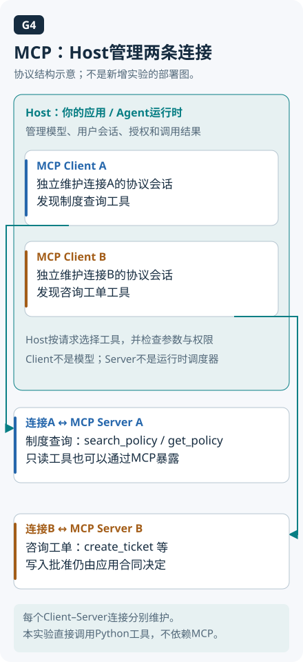

<!-- Generated question article; edit the canonical question in docs/foundations/04-tools-memory-protocols.md, then run python3 scripts/check_repo.py --write-index. -->

# Q028 MCP 的 Host、Client、Server 分别负责什么？

**优先级：P0**

## 简要回答

MCP 连接 AI 应用与外部能力。以学习助手接文档服务为例，承载用户与模型交互的应用是 Host，它内部负责这条协议会话的组件是 Client，提供工具和资源的服务是 Server。沿一条连接认角色，比按机器数量数角色更清楚。协议统一发现和调用方式，规划、业务逻辑及当前任务该用什么工具仍由应用决定。[MCP 架构](https://modelcontextprotocol.io/docs/learn/architecture)

## 详细解析

先按连接辨认Host、Client与Server的职责，不把逻辑角色直接等同于三台机器。

Host 是用户正在使用的 AI 应用，负责组织模型、用户交互、连接与应用策略；Client 是 Host 内负责与某个 Server 建立协议交互的组件；Server 暴露工具、资源等能力。它们是职责，不是必须对应三台机器。桌面学习助手可以在同一机器启动本地服务，也可以通过网络连接远程服务，认角色时沿“谁管理会话、谁提供能力”来标注，不能只数进程或容器。

一次接入需要建立连接并协商协议与能力，再按支持情况发现工具或资源，调用后处理结果和错误。MCP 2025-11-25 工具规范描述 tools/list 与 tools/call 等合同，但具体交互和批准方式由应用组织。发现能力不代表当前任务应调用，也不证明用户有权使用某个对象；Server 仍执行业务权限，Host 也需控制哪些内容进入模型及哪些动作允许执行。

新增服务意味着新增连接、身份和信任边界。一个 Host 可以管理面向多个服务的 Client，不能把文档服务令牌任意交给工单服务，也不能让一个工具输出变成另一个服务的高权限指令。本地 stdio 与远程 HTTP 在进程权限、凭据和网络上有不同假设，应分别设计。统一协议减少接入形状差异，却不包办规划、记忆、可靠重试或业务验收；系统仍要定义对象状态、失败处理和完成条件，不能因连接成功就宣布 Agent 能可靠完成任务。

## 常见追问

1. **Client 是用户还是模型吗？** 这里指 Host 中实现协议交互的组件。模型可能建议调用哪个工具，但不是因此就成为负责连接、鉴权和执行的协议 Client。
2. **Server 必须远程部署吗？** 不必。它可以是本地进程或远程服务，传输不同会改变部署与安全边界；角色由职责决定，而不是由是否跨机器决定。
3. **MCP 和 Agent 框架有什么关系？** MCP 提供能力交换合同，框架可以组织模型循环和状态并接入 MCP。协议本身不替应用规划任务，也不天然提供可靠长期记忆。

## 实战案例

桌面学习助手先连接文档服务，后增加工单服务。初版团队把二者当成同一个“工具服务器”，共享凭据并让任意结果触发下一调用。处理时标明 Host、两条 Client–Server 连接、各自能力和身份范围，读取文档与创建工单分开控制。验收确认文档检索成功不自动允许工单写入，服务断开有明确错误，第二服务返回的状态仍需对应实际工单，不能由“协议连接正常”替代任务完成。

## 常见误区

把 MCP 叫完整 Agent 框架；按机器数判断角色；认为接上协议就自动获得规划、记忆、授权与可靠执行。

## 动手想一想

标注桌面学习助手连接文档与工单服务的三类角色。验收：画出两条连接、各自凭据和允许动作，并解释本地进程与远程 HTTP 哪些信任假设不同。

## 学习参考

[学习章：工具与 MCP](../learning/05-tools-and-mcp.md) · [MCP 架构](https://modelcontextprotocol.io/docs/learn/architecture) · [MCP 2025-11-25 Tools](https://modelcontextprotocol.io/specification/2025-11-25/server/tools)

---

[上一题：Q027](Q027.md) · [全部题目](README.md) · [下一题：Q029](Q029.md)

[按模块阅读](../docs/foundations/04-tools-memory-protocols.md#q028-mcp-的-hostclientserver-分别负责什么)
